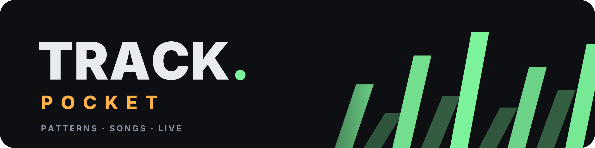
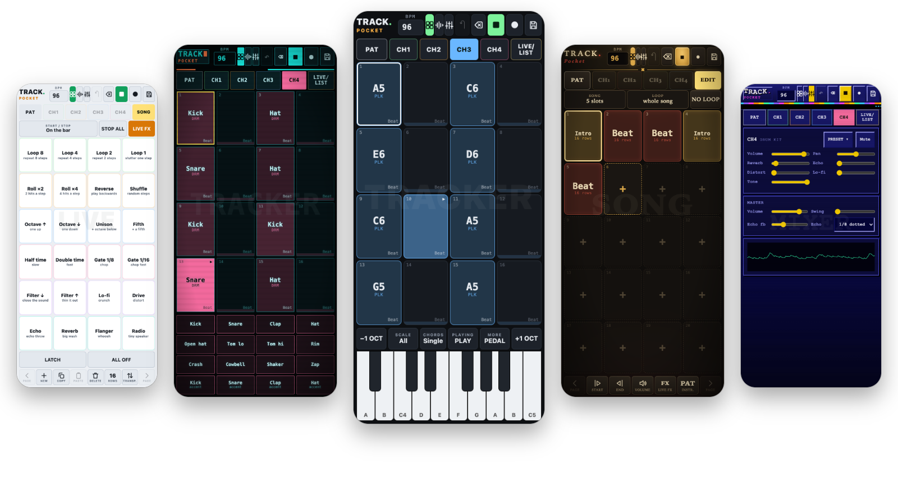
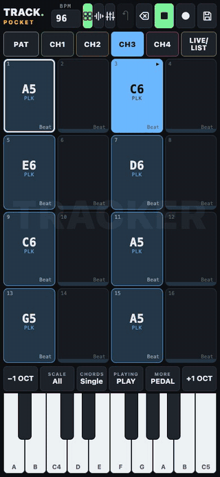
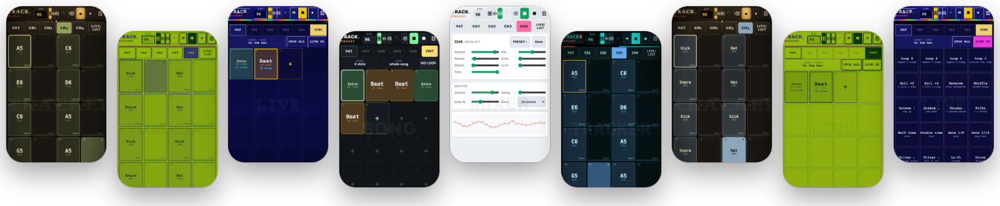
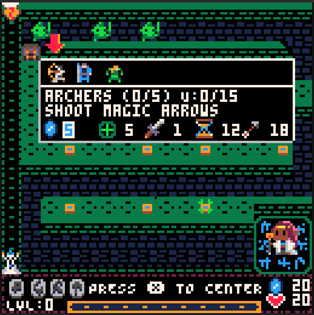
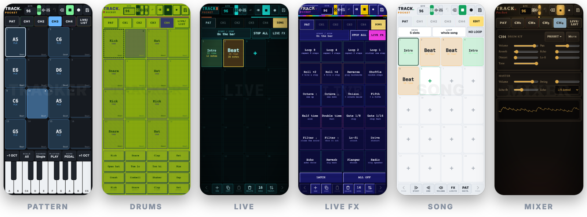
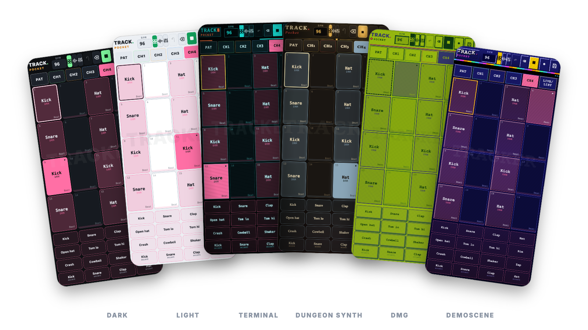

# TRACK.Pocket

So, after collecting a lot of gadgets and buying lots of music apps, I found out that I was still missing some simplicity for quick music making. I love the Pico-8 tracker and my Pocket Operator KO, so I took some old code, spent some time furiously drawing on notebooks and fed it all to the token burner machine. 

Thus came TRACK.Pocket, a small, browser-based pocket music maker. It runs from one self-contained HTML file, with no install or network connection required. Its one third-party library (the MP3 encoder) is bundled inside that file, so there are no other requests or dependencies. 

It should run fully offline, although opening the HTML file directly can cause microphone permission issues, so use the hosted GitHub page instead or self-host the HTML.

**Open it:** [utopick.github.io/track-pocket](https://utopick.github.io/track-pocket/) · **Install it:** it is a web app (PWA): on Android, Chrome ▸ **Install app**; on iPhone, Safari ▸ Share ▸ **Add to Home Screen**; on a computer, the install icon in the address bar. Once installed it opens like an app and works offline.

I've been adding features and tweaking a lot, so they come out not fully tested, and there could be bugs. Leave me an issue and I'll fix it.

There is a help wiki inside (también en español), so don't worry, but it should be quite straightforward. It has small interactive demos you can touch and hear: a pattern, the live FX pads and the sampler's grid and quantize.

## Why did I release these apps? 

Because GitHub allows me to host them in a GitHub site if I make them public, and I don't want to host them myself. 

Also because my friends told me that they are useful and some of you may want a free, ad-less gadget to pass the time.

## Ads and cookies

Yeah, no. 

No ads, no cookies, no nothing. This is free and clean. No hidden stealers, no weird intentions. 

Why is it free? Because not everything should be a product. 

## AI use

I'm a programmer and I have been coding for a living for over two decades, but life has given me too little free time that I want to spend offline and outside, making music and art. So I used a lot of AI to build this in a quick and easy way.

I'm not going to take credit for the code, even though I started this app from my own older code. I built it with the help of an AI coding assistant (Claude, by Anthropic), which wrote and reworked much of the code following my literally scanned designs and notes. And some hyperfocused allnighters too. Also Codex helped, so yeah, he tried his best.

The app itself uses no AI: everything runs on your device, and nothing you play, sing or record is sent to any AI service or anywhere else for that matter. If that isn't the case just shame me publicly and I'll fix it.

I did waste a lot of tokens by making it code it in a non-minified way, so if the bubble bursts and we go back to the basics it could be maintainable. 

If you want to try something made by me by hand (95%, I did use an early model to find some bugs but solved them by hand) in which I made the code, assets, music and all, check out Nanaya, my Pico-8 tower defense game: https://www.lexaloffle.com/bbs/?tid=153336

## How to run it

Open `index.html` in a modern web browser. Start playback with **▶**. Your browser may ask for permission to play audio, so interact with the page first if you hear nothing.

The microphone needs `https://` or `localhost`, which is why the hosted page (or the installed app) is the easy way.

## The basics

If you've ever used a groovebox or tracker, you've got it. If not, it should be pretty intuitive, and if it's not, then it's my fault.

- **Patterns:** add notes to the step grid, choose instruments, and build a repeating phrase.
- **Playback:** adjust the tempo and press play to hear the current pattern. Use the song and live views to arrange or perform patterns.
- **Playing along:** the keys play while the pattern runs without writing anything. Turn **PLAYING · WRITE** on to write into the selected step as the pattern plays, or press **●** to record each note on the step you hear. On a computer, the keyboard plays the keys, the drum pads and the FX pads, and each pad shows its key.
- **Sampler:** record or open a sound into one of 16 slots, then crop, reverse, normalize or add effects. In **MORE**, an optional **GRID** lays the song's steps over the wave so a selection snaps to whole steps, and **QUANTIZE** moves the hits onto it to tighten a loose beat.
- **Live FX:** open the FX pads and hold one to apply it; release to turn it off. **Latch** keeps an effect on after you release it. **Off** clears active effects. The FX board includes loop/repeat, rolls, pitch, filter, and other performance effects.
- **Save:** use the file controls to save and load songs. TRACK.Pocket also keeps browser-local autosave data.

### Themes

Six looks, from **THEME** at the bottom of the files screen: Dark, Light, Terminal, Dungeon synth, DMG and Demoscene. All three Pocket apps share them.

### Your songs

Songs and settings are stored in your browser (in IndexedDB, which gives you plenty of space, and you can export them); they are not uploaded anywhere. Clearing browser storage removes local saves.

## Install it as an app (PWA)

TRACK.Pocket is a progressive web app (PWA): the hosted page can be installed on the home screen or desktop, opens in its own window without browser bars, and keeps working with no connection. There is no store and no download. The first visit has to be online; after that it starts offline.

### iPhone and iPad (iOS)

1. Open [utopick.github.io/track-pocket](https://utopick.github.io/track-pocket/) in **Safari** (other iOS browsers cannot install web apps from the share menu).
2. Tap **Share**, then **Add to Home Screen**, then **Add**.
3. Open it from the new icon. The microphone asks for permission the first time you use it.

Notes: Safari on iOS has no Web MIDI, so MIDI keyboards and pads do not work there. On iOS, Safari deletes the data of websites you have not used for 7 days, but an app added to the Home Screen is exempt from that rule: so install it, rather than keeping it in a Safari tab. Even so, export what you want to keep (iOS can still free storage when the phone is nearly full).

### Android

1. Open the page in **Chrome** (Edge, Brave and Samsung Internet work too).
2. Choose menu ⋮ ▸ **Install app** (or **Add to Home Screen**), or accept the install banner if it shows.
3. Open it from the icon. Allow the microphone when asked; if you refused it, tap the lock icon in the address bar of a normal tab (or **Settings ▸ Apps ▸ TRACK.Pocket ▸ Permissions**).

MIDI keyboards and pads over USB or Bluetooth work in Chrome (Web MIDI).

### Desktop (Windows, macOS, Linux, ChromeOS)

1. Open the page in **Chrome** or **Edge** and click the install icon at the right end of the address bar (or menu ▸ **Install TRACK.Pocket**).
2. It opens in its own window and can be pinned to the taskbar or dock.
3. Firefox and Safari on desktop can use the page in a tab, but do not install it; Firefox also has Web MIDI, Safari does not.

### Good to know

- **Updates:** whenever it is online the app fetches the newest version; close and reopen it to run it.
- **Your data** lives in the browser's storage for this site (the installed app and a tab of the same browser share it). Export songs and recordings you want to keep before clearing browser data or switching device.
- **The Android APK is retired.** It was a Capacitor wrapper of this same page; the PWA does the same job without a build. The code stays in the [`android-legacy`](https://github.com/utopick/track-pocket/tree/android-legacy) branch and the old APKs in [Releases](https://github.com/utopick/track-pocket/releases); neither gets updates.

### Why is there a service worker (`sw.js`)?

Browsers only allow an app to work offline, and only offer to install it, if the site registers a **service worker**: a small script that sits between the page and the network. This one does a single job: on the first visit it saves the app's own files (`index.html`, the manifest and the icons) in the browser's cache, and afterwards it answers from that cache when you are offline. It asks the network first, so when you are online you always get the latest version. It cannot be part of `index.html`, because browsers load it as a separate file, and it never touches your songs, recordings, microphone or MIDI, and sends nothing anywhere.

## Files

- `index.html` — the complete app (markup, styles, audio code and the MIDI panel)
- `manifest.webmanifest`, `sw.js`, `icons/` — what makes it installable and offline (see above)
- `docs/` — notes for whoever maintains it; `tests/` — automated checks (`tests/e2e.py`, Selenium) and a test for the MIDI helpers
- `LICENSE` — license terms

## License

TRACK.Pocket is released under the MIT License (see `LICENSE`).

AI assisted coding uses the uncredited work of a lot of coders through the years (me included) so anything I make that's not for work its as free as possible.

Have fun.

### Third-party code

The banner, app icons and favicons are lettered in [Inter](https://rsms.me/inter/) (SIL Open Font License 1.1), converted to shapes, so no font file is included.

`index.html` bundles **lamejs 1.2.1** (the MP3 encoder, a JavaScript port of LAME) in its own `<script id="lamejs">` block. lamejs is **not** covered by the MIT License: it is licensed under the [GNU Lesser General Public License v3.0](https://www.gnu.org/licenses/lgpl-3.0.html). It is included unmodified; its source is at <https://github.com/zhuker/lamejs> (npm package `lamejs@1.2.1`). You may replace that block with any other compatible build of lamejs.

## The readmes

Yeah. They are all similar. I copied and pasted. No one ever reads them all. Kilroy was here.

Anyway, listen to me: You matter. A lot. I don't know you stranger, but you have my admiration and love. Keep making art.